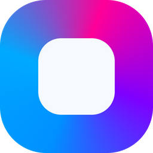
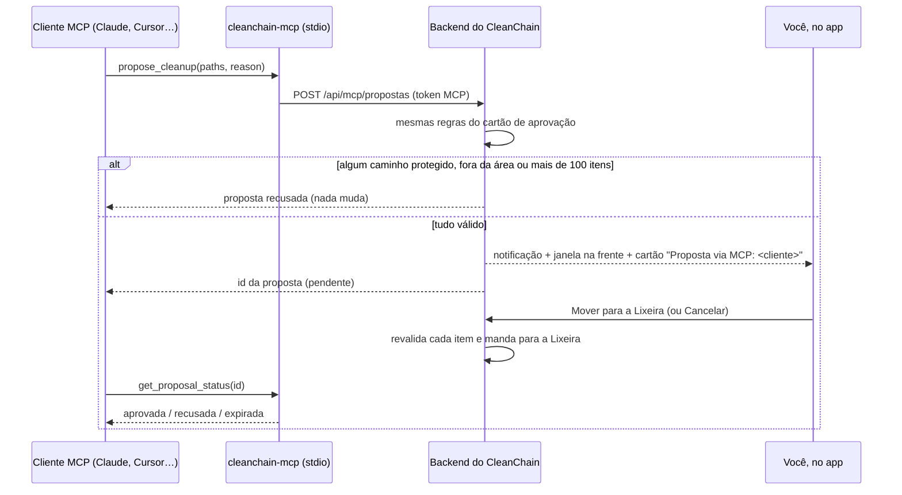
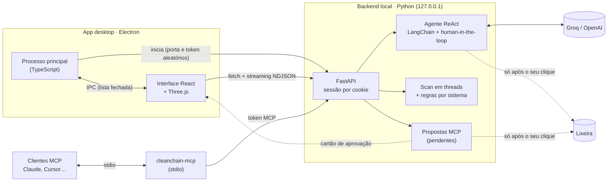

<p align="center">
  
</p>

<h1 align="center">CleanChain</h1>

<p align="center">
  <b>Um agente de IA que mostra o que ocupa o seu disco e limpa com você — e só apaga com a sua aprovação.</b>
</p>

<p align="center">
  <a href="https://github.com/GuiMRDS/CleanChain/releases/latest"></a>
  <a href="LICENSE"></a>
  
  <a href="https://github.com/GuiMRDS/CleanChain/actions/workflows/ci.yml"></a>
</p>

<p align="center">
  <a href="#download">Download</a> ·
  <a href="#funcionalidades">Funcionalidades</a> ·
  <a href="#segurança-e-privacidade">Segurança</a> ·
  <a href="#usando-via-mcp">MCP</a> ·
  <a href="#arquitetura">Arquitetura</a> ·
  <a href="#desenvolvimento">Desenvolvimento</a>
</p>

<!-- TODO: GIF de demonstração (roteiro em docs/roteiro-demo.md; salvar como docs/images/demo.gif) -->


---

## Por que o CleanChain

- **Seguro por padrão.** Pastas do sistema, programas, a sua pasta de usuário e dados sensíveis
  nunca são apagados. Cada item é validado duas vezes — ao montar o cartão de aprovação e de novo
  na hora de apagar — e tudo vai para a **Lixeira**, de onde dá para restaurar.
- **Você aprova cada limpeza.** O agente propõe; nada sai do lugar até você clicar em
  *Mover para a Lixeira*, vendo cada item e o total que será liberado.
- **Um agente que explica.** Converse em português: ele mostra o que ocupa espaço, abre as pastas
  no mapa enquanto explica e aponta caches, duplicados confirmados e arquivos esquecidos.
- **Funciona com outros agentes.** Pelo protocolo MCP, assistentes como Claude Desktop, Claude
  Code e Cursor consultam as suas análises e **propõem** limpezas — que você aprova no app.

## Download

Baixe o instalador do seu sistema no [último Release](https://github.com/GuiMRDS/CleanChain/releases/latest):

| Sistema | Instalador (versão 1.0.0) |
|---|---|
| **Windows** 10 e 11 (64 bits) | [CleanChain-Setup-1.0.0.exe](https://github.com/GuiMRDS/CleanChain/releases/download/v1.0.0/CleanChain-Setup-1.0.0.exe) |
| **macOS** 12+ (Apple Silicon) | [CleanChain-1.0.0-mac-arm64.dmg](https://github.com/GuiMRDS/CleanChain/releases/download/v1.0.0/CleanChain-1.0.0-mac-arm64.dmg) |
| **Linux** x64 (Ubuntu/Debian) | [CleanChain-1.0.0-linux-amd64.deb](https://github.com/GuiMRDS/CleanChain/releases/download/v1.0.0/CleanChain-1.0.0-linux-amd64.deb) |
| **Linux** x64 (outras distribuições) | [CleanChain-1.0.0-linux-x86_64.AppImage](https://github.com/GuiMRDS/CleanChain/releases/download/v1.0.0/CleanChain-1.0.0-linux-x86_64.AppImage) |

Você vai precisar de uma chave de API da **Groq** (gratuita) ou da **OpenAI**. Na primeira
abertura, escolha o provedor e cole a chave; ela fica no cofre de senhas do sistema.

<details>
<summary><b>Instalação passo a passo e avisos de cada sistema</b> (SmartScreen, Gatekeeper, Linux)</summary>

#### Windows

1. Baixe e execute o `.exe`. Ele instala só para o seu usuário (não pede administrador) e cria
   atalhos na área de trabalho e no menu Iniciar.
2. O app se atualiza sozinho: baixa a versão nova em segundo plano e oferece reiniciar.

> **Instalador sem assinatura de código.**
> - **SmartScreen** ("O Windows protegeu o computador"): **Mais informações › Executar assim mesmo**.
> - **Smart App Control** (Windows 11): quando está **ligado**, bloqueia programas sem
>   assinatura e **não oferece** "executar assim mesmo". Veja o estado em *Segurança do
>   Windows › Controle de aplicativos e navegador › Smart App Control*. Desligar é uma
>   decisão sua e **não dá para religar** sem reinstalar o Windows; a solução definitiva é o
>   instalador assinado. O pipeline já está pronto para assinar: veja
>   [docs/assinatura.md](docs/assinatura.md).

#### macOS

1. Abra o `.dmg` e arraste o **CleanChain** para **Aplicativos**.
2. **Primeira abertura (Gatekeeper):** o app não tem assinatura nem notarização da Apple, então
   o macOS avisa que "não pôde verificar" o app. Para abrir:
   1. tente abrir o CleanChain uma vez e feche o aviso;
   2. vá em **Ajustes do Sistema › Privacidade e Segurança**, role até "O CleanChain foi
      bloqueado…" e clique em **Abrir Mesmo Assim**;
   3. confirme com a sua senha. Das próximas vezes ele abre direto.
3. Para analisar pastas como Mail, Mensagens ou Safari, conceda **Acesso Total ao Disco** em
   *Ajustes do Sistema › Privacidade e Segurança › Acesso Total ao Disco*. Sem isso o scan
   continua, mas essas pastas aparecem como sem permissão.
4. **Atualizações:** sem a assinatura da Apple, o macOS não deixa o app se atualizar sozinho.
   O menu do app avisa quando há versão nova e abre a página de download.

#### Linux

- **`.deb` (Ubuntu/Debian, recomendado):** `sudo apt install ./CleanChain-<versão>-linux-amd64.deb`.
  Ele instala também o perfil AppArmor que o Ubuntu 24.04+ exige para o sandbox do Chromium.
- **`.AppImage`:** `chmod +x CleanChain-*.AppImage` e execute. No Ubuntu 24.04+ o AppImage
  pode não abrir por causa da restrição de sandbox do AppArmor; nesse caso, use o `.deb`.
  (O app **não** desliga o sandbox para contornar isso.)
- **Cofre de senhas:** a chave do LLM fica no GNOME Keyring ou no KWallet. **Sem um deles, o
  app não salva a chave** (seria texto puro) e explica isso na tela; instale com
  `sudo apt install gnome-keyring` e abra o app de novo.
- **Atualizações:** o AppImage se atualiza sozinho; no `.deb`, o menu do app avisa e abre a
  página de download (instalar pediria senha de administrador).

#### Onde ficam os dados

| Sistema | Pasta (scans, chave cifrada e `logs/`) |
|---|---|
| Windows | `%APPDATA%\CleanChain` |
| macOS | `~/Library/Application Support/CleanChain` |
| Linux | `~/.config/CleanChain` |

Desinstalar remove o app e mantém essa pasta; apague-a para limpar tudo.

</details>

## Funcionalidades

| Escolha do disco | Scan em andamento |
|---|---|
|  |  |

| Resultado: oportunidades, mapa e tipos | Agente abrindo pastas no mapa |
|---|---|
|  |  |

- **Scan profundo por disco** — escolha `C:`, `D:`… no Windows, o disco ou volumes no macOS e no Linux (ou só a sua pasta de usuário). O
  scan percorre o disco inteiro em paralelo, com progresso em %, pode ser cancelado e
  salva o resultado em JSON.
- **Oportunidades de limpeza** — o scan encontra caches e temporários conhecidos
  (navegadores, npm/pip/Gradle/uv, Temp, Lixeira, node_modules…), **duplicados
  confirmados byte a byte**, arquivos grandes esquecidos há mais de um ano, a idade dos
  dados e as extensões que mais ocupam. O card mostra "Pode liberar ~X GB" e cada
  oportunidade abre uma conversa com o agente sobre ela.
- **Mapa de pastas (sunburst)** — 4 anéis de pastas, navegável por clique, com uma
  tabela que mostra subpastas **e arquivos** da pasta aberta; desce além dos anéis.
- **Tipos de arquivo** — rosca com vídeos, instaladores, imagens, documentos e outros.
- **Agente ReAct no chat** — respostas em streaming, mostrando cada passo
  (Ação → Observação), com memória por conversa.
- **O agente controla a tela** — enquanto explica, ele abre as pastas no sunburst
  (com o selo "aberta pelo agente") e sabe qual pasta você está vendo.
- **Limpeza com aprovação humana** — o agente propõe, a tela mostra um cartão com
  cada item e o total, e nada é apagado até você clicar em "Mover para a Lixeira".
- **Fale com o agente** — botão de microfone com transcrição (Whisper).
- **Servidor MCP** — outros assistentes de IA (Claude, Cursor, VS Code…) consultam as análises
  e propõem limpezas que você aprova no app (ver [Usando via MCP](#usando-via-mcp)).
- **Visual** — HUD em tema claro, fundo em grade animada e robô holográfico 3D.

## Segurança e privacidade

**O que o app acessa.** Só o disco ou a pasta que você escolhe escanear: nomes, caminhos,
tamanhos e datas dos arquivos. Para confirmar duplicados, ele compara o conteúdo de arquivos
grandes de mesmo tamanho — localmente, sem enviar nada.

**O que ele nunca faz.**
- Apagar sem o seu clique, ou apagar de forma permanente (tudo vai para a Lixeira).
- Mexer em pastas do sistema e de programas, na sua pasta de usuário e nas principais dela, em
  dados sensíveis (chaves SSH, Keychain, iCloud…), em arquivos de sistema, em atalhos ou fora da
  área escaneada — com no máximo 100 itens por operação. As regras de cada sistema estão em
  [docs/seguranca-por-sistema.md](docs/seguranca-por-sistema.md).
- Enviar telemetria, estatísticas de uso ou relatórios de falha.
- Aceitar conexões de fora do seu computador: o serviço local escuta só em `127.0.0.1` e exige
  uma sessão criada pelo próprio app.

**Onde ficam os dados.** Na sua máquina, na pasta de dados do app (`%APPDATA%\CleanChain`,
`~/Library/Application Support/CleanChain` ou `~/.config/CleanChain`): os resultados dos scans,
a chave da API **cifrada** pelo cofre do sistema e os logs. As conversas ficam só na memória e
somem ao fechar o app.

**Para onde vai o conteúdo enviado ao modelo.** Quando você conversa com o agente, a sua
mensagem e o que ele consulta para responder (resumos da análise: nomes e caminhos de pastas e
arquivos, tamanhos e datas — incluindo o caminho da sua pasta de usuário) vão para o provedor
que você configurou, **Groq** ou **OpenAI**. Ao usar o microfone, o áudio vai para o mesmo
provedor para ser transcrito. O conteúdo dos seus arquivos não é enviado.

Detalhes completos na [Política de privacidade](PRIVACIDADE.md).

## Usando via MCP

O CleanChain também funciona como **servidor MCP** ([Model Context Protocol](https://modelcontextprotocol.io)),
o padrão aberto que assistentes de IA usam para chamar ferramentas. Qualquer cliente MCP
(Claude Desktop, Claude Code, Cursor, VS Code e outros agentes) pode consultar as suas análises
e **propor** limpezas. **Nenhum cliente MCP consegue apagar nada**: cada proposta vira um
cartão de aprovação no app, e só você decide.

### O que dá para fazer

| Ferramenta | O que faz | Somente leitura |
|---|---|:---:|
| `get_last_scan_summary` | Resumo da última análise: total, tipos de arquivo, maiores arquivos e pastas | ✓ |
| `get_folder_details(path)` | Detalhes de uma pasta da análise (subpastas e tamanhos) | ✓ |
| `get_cleanup_opportunities(kind)` | Caches, duplicados, arquivos esquecidos, extensões e idades | ✓ |
| `list_folder(path)` | Arquivos de uma pasta da área analisada (para achar caminhos exatos) | ✓ |
| `propose_cleanup(paths, reason)` | Cria uma **proposta** de limpeza para você aprovar no app | — |
| `get_proposal_status(id)` | Situação da proposta: pendente, aprovada, recusada ou expirada | ✓ |

Não existe ferramenta MCP para aprovar ou apagar. Os clientes leem as análises que **você**
rodou no app (o MCP não escaneia o disco).

### Como ligar

1. Abra o CleanChain e vá em **menu do app › Integração MCP**.
2. Ligue o **Servidor MCP** (ele vem desligado).
3. Clique em **Copiar configuração** do seu cliente e cole no lugar indicado (veja abaixo).
4. Reinicie o cliente. Com o CleanChain aberto, ele passa a enxergar as ferramentas.

Com o app fechado ou a integração desligada, as ferramentas respondem *"O CleanChain não está
aberto. Abra o app e tente de novo."*

### Onde fica o executável

O servidor MCP é o executável `cleanchain-mcp`, instalado junto com o app (transporte stdio):

| Sistema | Caminho |
|---|---|
| Windows | `%LOCALAPPDATA%\Programs\CleanChain\resources\mcp\cleanchain-mcp.exe` |
| macOS | `/Applications/CleanChain.app/Contents/Resources/mcp/cleanchain-mcp` |
| Linux (`.deb`) | `/opt/CleanChain/resources/mcp/cleanchain-mcp` |

No **AppImage** o caminho muda a cada abertura, então a integração MCP precisa do `.deb`. A tela
"Integração MCP" mostra o caminho exato da sua instalação.

### Configuração dos clientes

O botão **Copiar configuração** já gera o texto com o caminho certo. Os exemplos abaixo usam o
caminho do Windows; troque pelo do seu sistema.

**Claude Desktop**: em *Settings › Developer › Edit Config* (`claude_desktop_config.json`):

```json
{
  "mcpServers": {
    "cleanchain": {
      "command": "C:\\Users\\<você>\\AppData\\Local\\Programs\\CleanChain\\resources\\mcp\\cleanchain-mcp.exe",
      "args": []
    }
  }
}
```

**Claude Code**: no terminal:

```sh
claude mcp add --scope user cleanchain -- "C:\Users\<você>\AppData\Local\Programs\CleanChain\resources\mcp\cleanchain-mcp.exe"
```

**Cursor**: em `~/.cursor/mcp.json` (mesmo formato do Claude Desktop):

```json
{
  "mcpServers": {
    "cleanchain": {
      "command": "/Applications/CleanChain.app/Contents/Resources/mcp/cleanchain-mcp",
      "args": []
    }
  }
}
```

Outros clientes MCP (VS Code, agentes próprios) usam o mesmo comando com transporte **stdio**.

### Fluxo de aprovação



- A proposta passa pelas **mesmas regras** do chat (pastas protegidas, área escaneada, até 100
  itens) e é **recusada inteira** se qualquer caminho for bloqueado.
- Ao chegar uma proposta, o app mostra uma notificação do sistema e traz a janela para a frente,
  com o cartão de aprovação e o selo **"Proposta via MCP: <nome do cliente>"** (o nome que o
  cliente informa ao conectar).
- **Só o seu clique no app apaga**, com a mesma validação dupla de sempre (no cartão e de novo
  na hora de mandar para a Lixeira). Propostas sem decisão **expiram em 30 minutos**.

### Segurança da integração

- O app grava `runtime.json` (porta, um token MCP novo a cada abertura e o PID) na pasta de dados,
  com permissão só para o seu usuário, **apenas com a integração ligada**, e o apaga ao desligar ou
  ao fechar o app.
- As rotas `/api/mcp/*` aceitam **só** esse token e só leem ou criam propostas. As rotas de
  aprovação exigem a sessão da interface do app, e o token MCP não chega nelas.
- Com a integração desligada, o backend recusa todas as rotas MCP.

## Arquitetura



- **Electron + backend Python.** O app inicia o backend (empacotado com PyInstaller) como
  processo filho, numa porta livre com um token de uso único trocado por um cookie de sessão; a
  interface é servida pelo próprio backend, na mesma origem. Ao sair, nenhum processo sobra.
- **Agente.** Um agente ReAct do LangChain com ferramentas para ler a análise, listar pastas,
  controlar o mapa da tela e apagar — esta última pausada pelo `HumanInTheLoopMiddleware` até a
  sua decisão.
- **Camada de plataforma.** Tudo o que muda entre Windows, macOS e Linux (pastas protegidas,
  discos, caches conhecidos, links, Lixeira) fica num lugar só, no backend e no Electron.
- **MCP.** Um executável separado fala MCP por stdio com qualquer cliente e repassa ao backend
  só leitura e propostas — nunca aprovação nem exclusão.

Diagramas detalhados, API e estrutura de pastas: [docs/desenvolvimento.md](docs/desenvolvimento.md).

## Destaques técnicos

Para quem quer saber como foi feito:

- **Agente ReAct com LangChain** (`create_agent`) com memória por conversa, streaming de cada
  passo (ação → observação → resposta) num contrato NDJSON e ferramentas que controlam a tela
  (o agente abre pastas no mapa enquanto explica). — [`backend/app/agent.py`](backend/app/agent.py), [`stream.py`](backend/app/stream.py)
- **Human-in-the-loop de verdade.** A exclusão é pausada pelo middleware do LangGraph e só
  continua com a decisão do usuário; propostas vindas de outros agentes seguem o mesmo caminho.
  As regras críticas estão no código, não no prompt. — [`tools/cleanup.py`](backend/app/tools/cleanup.py), [`propostas.py`](backend/app/propostas.py)
- **Regras de segurança com dupla validação e testes.** As regras ficam numa parte pura
  (testável com caminhos simulados de qualquer sistema) e numa parte que consulta o disco.
  São 167 casos simulados dos três sistemas e um retrato de 631 caminhos que trava as regras do
  Windows, além de 356 testes no backend. — [`files.py`](backend/app/files.py), [`plataforma/`](backend/app/plataforma), [`tests/`](backend/tests)
- **Scan rápido e determinístico.** A varredura usa threads (com o número medido, não chutado),
  e a detecção de duplicados é feita em duas etapas (hash parcial → hash completo, ignorando
  hardlinks). — [`tools/disk_scan.py`](backend/app/tools/disk_scan.py), [`scan_insights.py`](backend/app/scan_insights.py)
- **Electron endurecido com backend Python empacotado.** `contextIsolation`, `sandbox`, CSP
  restrita, IPC com lista fechada, Electron Fuses, protocolo próprio para as telas locais e
  sessão por token de uso único. — [`desktop/main/`](desktop/main)
- **Servidor MCP** com o SDK oficial (stdio), token próprio e propostas que expiram, testado de
  ponta a ponta com um cliente MCP real. — [`backend/cleanchain_mcp/`](backend/cleanchain_mcp)
- **CI/CD multiplataforma.** GitHub Actions em matriz (Windows, macOS, Linux): testes, build,
  teste de fumaça do app de verdade (inclusive do executável final com Fuses), instaladores e
  publicação por tag; o pipeline já está pronto para assinatura de código. — [`.github/workflows/`](.github/workflows)

## Desenvolvimento

Requisitos: Node.js 20+, Python 3.12+ e [uv](https://docs.astral.sh/uv/).

```sh
# backend: testes
cd backend && uv sync && uv run python -m pytest

# app desktop em modo de desenvolvimento (Vite + Electron; o Electron inicia o backend)
cd frontend && npm install
cd ../desktop && npm install && npm run dev

# teste de fumaça: abre o app de verdade com um perfil temporário
cd desktop && npm run test:fumaca

# instaladores deste sistema
cd desktop && npm run dist
```

O guia completo — variáveis de ambiente, modo navegador, API, estrutura do projeto, ícone e como
publicar um Release — está em [docs/desenvolvimento.md](docs/desenvolvimento.md). Para agentes
de código (Claude, Codex, Cursor…), o contexto e as regras do projeto estão em
[AGENTS.md](AGENTS.md). Mudanças de cada versão: [CHANGELOG.md](CHANGELOG.md).

## Licença e créditos

Distribuído sob a licença [MIT](LICENSE).

O fundo animado e o robô holográfico foram inspirados no template **Clarix** (GetLayers).
