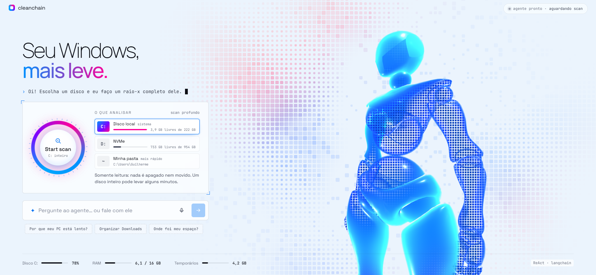
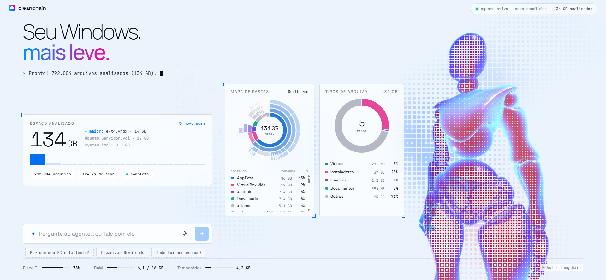
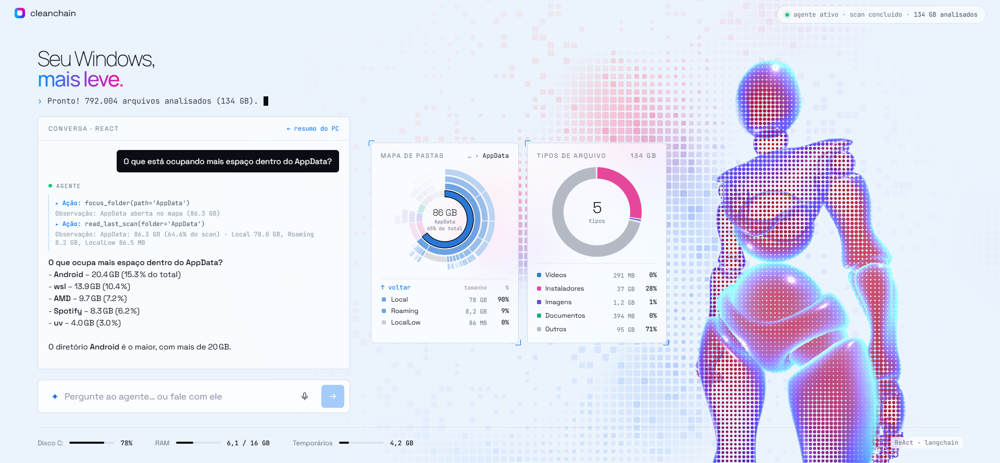
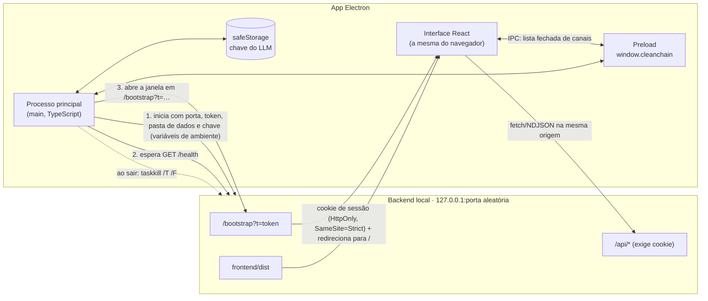

# CleanChain

**Um "CleanMyMac" para Windows com um agente de IA dentro.** Você escolhe um disco, o
CleanChain faz um raio-x completo dele e um agente ReAct (LangChain) conversa com você
sobre o que está ocupando espaço: abre as pastas no mapa enquanto explica, encontra
o que dá para limpar e, **só com a sua confirmação**, manda os arquivos para a Lixeira.

Roda como **app desktop para Windows** (Electron) ou, para desenvolvimento, no navegador.



---

## Instalação (app desktop)

1. Baixe `CleanChain-Setup-<versão>.exe` em
   [Releases](https://github.com/GuiMRDS/CleanChain/releases).
2. Execute o instalador. Ele instala só para o seu usuário (não pede administrador) e cria
   atalhos na área de trabalho e no menu Iniciar.
3. Na primeira abertura, escolha o provedor (**Groq**, gratuito, ou **OpenAI**) e cole a sua
   chave de API. Ela fica criptografada neste computador; dá para trocar depois em
   **Arquivo › Configurar chave do LLM**.

O app se atualiza sozinho: quando sai uma versão nova, ele baixa em segundo plano e pergunta
se pode reiniciar.

> **Aviso do Windows (instalador sem assinatura).** O instalador ainda não tem certificado
> de assinatura de código.
> - **SmartScreen** ("O Windows protegeu o computador"): clique em **Mais informações ›
>   Executar assim mesmo**.
> - **Smart App Control** (Windows 11): quando ele está **ligado**, bloqueia programas sem
>   assinatura e **não oferece** "executar assim mesmo". Veja o estado em *Segurança do
>   Windows › Controle de aplicativos e navegador › Smart App Control*. Desligar é uma
>   decisão sua e **não dá para religar** sem reinstalar o Windows; a solução definitiva é o
>   instalador assinado, previsto para uma próxima versão.

**Onde ficam os dados:** `%APPDATA%\CleanChain` (scans, chave cifrada e logs em `logs\`).
Desinstalar pelo Windows remove o app e mantém essa pasta; apague-a para limpar tudo.

---

## Funcionalidades

- **Scan profundo por disco** — escolha `C:`, `D:`… (ou só a sua pasta de usuário). O
  scan percorre o disco inteiro em paralelo, com progresso em %, pode ser cancelado e
  salva o resultado em JSON.
- **Oportunidades de limpeza** — o scan encontra caches e temporários conhecidos
  (navegadores, npm/pip/Gradle/uv, Temp, Lixeira, node_modules…), **duplicados
  confirmados byte a byte**, arquivos grandes esquecidos há mais de um ano, a idade dos
  dados e as extensões que mais ocupam. O card mostra "Pode liberar ~X GB" e cada
  oportunidade abre uma conversa com o agente sobre ela.
- **Mapa de pastas (sunburst)** — 4 anéis de pastas, navegável por clique, com uma
  tabela que mostra subpastas **e arquivos** da pasta aberta; desce além dos anéis.
- **Tipos de arquivo** — rosca com vídeos, instaladores, imagens, documentos e outros.
- **Agente ReAct no chat** — respostas em streaming, mostrando cada passo
  (Ação → Observação), com memória por conversa.
- **O agente controla a tela** — enquanto explica, ele abre as pastas no sunburst
  (com o selo "aberta pelo agente") e sabe qual pasta você está vendo.
- **Limpeza com aprovação humana** — o agente propõe, a tela mostra um cartão com
  cada item e o total, e nada é apagado até você clicar em "Mover para a Lixeira".
- **Fale com o agente** — botão de microfone com transcrição (Whisper).
- **Visual** — HUD em tema claro, fundo em grade animada e robô holográfico 3D.

## Interface

| Escolha do disco | Scan em andamento |
|---|---|
|  |  |

| Resultado: resumo, sunburst e tipos | Agente abrindo pastas no mapa |
|---|---|
|  |  |


---

## Como funciona

```mermaid
flowchart LR
    subgraph Front["Frontend · React + Vite"]
        UI[Start scan / Sunburst / Chat]
    end
    subgraph Back["Backend · FastAPI"]
        API[/api/*]
        AG[Agente ReAct<br/>LangChain create_agent]
        HITL[HumanInTheLoop<br/>middleware]
        SC[scan_disk]
        DB[(data/scans/latest.json)]
    end
    LLM[(Groq / OpenAI)]

    UI -- "POST /api/scan (NDJSON: progresso → resultado)" --> API --> SC --> DB
    UI -- "POST /api/chat (NDJSON: ação, observação, resposta, ui, approval)" --> API --> AG
    AG <--> LLM
    AG -- "read_last_scan / list_folder" --> DB
    AG -- "focus_folder → evento ui" --> UI
    AG -- "delete_files" --> HITL -- "cartão de aprovação" --> UI
    UI -- "POST /api/chat/approval" --> HITL
```

- **O scan é do usuário, a análise é do agente.** O botão Start scan chama a ferramenta
  `scan_disk` no backend, que salva o resultado. O agente **não escaneia**: ele só lê a
  última análise salva.
- **Tudo em streaming (NDJSON).** Chat, aprovação e scan respondem uma linha JSON por
  evento, então a tela mostra o raciocínio e o progresso ao vivo.
- **Apagar exige aprovação.** O `HumanInTheLoopMiddleware` pausa o loop antes de
  `delete_files`; o front mostra o cartão e retoma com a decisão.

### App desktop (Electron)



- **O backend é um processo filho.** O Electron inicia o executável do backend (empacotado
  com PyInstaller) numa porta livre aleatória, com um token aleatório de uso único, espera o
  `/health` e abre a janela em `/bootstrap?t=…`. O backend troca o token por um cookie de
  sessão e serve a interface buildada **na mesma origem** da API: `fetch` e streaming NDJSON
  funcionam sem CORS e sem `file://`.
- **Ninguém de fora usa a API.** Sem o cookie, só `/health` e `/bootstrap` respondem (401 no
  resto); o token vale uma vez; porta e token mudam a cada execução.
- **Nada fica rodando.** Ao fechar, o app encerra o backend e toda a árvore de processos
  (`taskkill /T /F`). Se o Electron for morto à força, o backend percebe e se encerra sozinho.
- **Se o backend cair**, o app avisa e oferece **Reiniciar**, sem fechar.

### Ferramentas do agente

| Ferramenta | O que faz |
|---|---|
| `read_last_scan(folder?)` | Resumo da última análise ou detalhes de uma pasta dela |
| `read_scan_insights(kind)` | Oportunidades de limpeza: resumo, caches, duplicados, esquecidos, extensões, idades |
| `list_folder(path)` | Arquivos de uma pasta (para achar caminhos exatos antes de limpar) |
| `focus_folder(path?)` | Abre a pasta no sunburst da tela (vira um evento `ui`) |
| `delete_files(paths, reason)` | Move itens para a Lixeira — **só depois da aprovação** |

### Segurança

- O scan é **somente leitura**; atalhos/junctions são ignorados.
- `delete_files` usa a **Lixeira do Windows** (dá para restaurar) e o backend recusa:
  pastas do sistema e de programas (`Windows`, `Program Files`, `ProgramData`…),
  `pagefile.sys` e afins, raiz de disco, a pasta do usuário e as pastas principais dela
  (Desktop, Downloads, AppData…), qualquer coisa fora da área escaneada e mais de 100
  itens por vez. A validação roda ao montar o cartão **e** de novo na hora de apagar.
- O backend escuta só em `127.0.0.1`, recusa *Host* externo e requisições de outras origens
  (sites abertos no navegador). Os scans salvos (`backend/data/`) ficam fora do git.
- No app desktop, a API exige o cookie de sessão; a pasta de instalação e a pasta de dados
  do próprio CleanChain também ficam protegidas contra exclusão.
- **Electron endurecido:** `contextIsolation`, `sandbox`, sem Node na interface, CSP
  restrita (no cabeçalho e aplicada pelo Electron), navegação e pop-ups bloqueados (links
  `https` abrem no navegador padrão), permissões negadas exceto o microfone, IPC só com
  canais listados e argumentos validados, e Electron Fuses (sem `RunAsNode`, sem
  `NODE_OPTIONS`/`--inspect`, integridade do ASAR validada).
- **A chave do LLM** fica cifrada com `safeStorage` (DPAPI do Windows) e só chega ao backend
  por variável de ambiente; nunca vai para log, disco em texto puro ou interface.

---

## Desenvolvimento

### Requisitos

- Windows 10/11 (a lista de discos e a Lixeira usam APIs do Windows)
- Node.js 20+ e npm
- Python 3.12+ e [uv](https://docs.astral.sh/uv/)
- Uma chave da **Groq** (grátis) ou da **OpenAI**

### 1. Chave do modelo

No modo navegador, crie um `.env` na raiz do projeto (ou em `backend/.env`). No app
desktop a chave é configurada na própria tela.

```env
GROQ_API_KEY=gsk_...
# ou
OPENAI_API_KEY=sk-...
```

| Variável | Padrão | Para quê |
|---|---|---|
| `GROQ_API_KEY` / `OPENAI_API_KEY` | — | Chave do LLM (OpenAI tem prioridade se as duas existirem) |
| `LLM_PROVIDER` | automático | Força `groq` ou `openai` |
| `GROQ_MODEL` | `openai/gpt-oss-20b` | Modelo do agente na Groq |
| `OPENAI_MODEL` | `gpt-6.2-astra` | Modelo do agente na OpenAI |
| `GROQ_STT_MODEL` / `OPENAI_STT_MODEL` | `whisper-large-v3-turbo` / `whisper-1` | Transcrição de voz |

### 2. Backend

```sh
cd backend
uv sync
uv run uvicorn app.server:app --reload --port 8000
```

Para conversar com o agente direto no terminal: `uv run python chat.py`.

Testes das regras de segurança (exclusão, aprovação humana, sessão, proteções da API):

```sh
uv run python -m pytest
```

### 3. Frontend (navegador)

```sh
cd frontend
npm install
npm run dev
```

Abra o endereço que o Vite mostrar (ex.: `http://localhost:5173`). O Vite repassa
`/api` para o backend na porta 8000.

### 4. App desktop em desenvolvimento

```sh
cd desktop
npm install
npm run dev        # Vite com hot reload + Electron; o Electron inicia o backend via uv
```

Não precisa subir o uvicorn à parte: o Electron inicia o backend (`uv run python -m
app.desktop`) na porta 8000 com sessão ligada, e o Vite repassa `/api`, `/bootstrap` e
`/health`. Se o `uv run` falhar na sua máquina, aponte para o Python da venv:
`CLEANCHAIN_PYTHON=..\backend\.venv\Scripts\python.exe`. Para abrir o Electron com a
interface buildada (sem Vite): `npm start`.

Teste de fumaça (abre o app de verdade com um perfil temporário):

```sh
npm run test:fumaca
```

### 5. Gerar o instalador

```sh
cd desktop
npm run dist       # build da interface → PyInstaller → TypeScript → instalador NSIS
```

Saída: `desktop/release/CleanChain-Setup-<versão>.exe`. Para publicar, suba a versão em
`desktop/package.json` e crie a tag igual (ex.: `v0.1.0`): o workflow **Release** testa,
gera e publica no GitHub Releases. Ele também pode ser disparado à mão (Actions › Release ›
Run workflow) para só gerar o instalador como artefato.

> Com o **Smart App Control** ligado, o Windows bloqueia o executável que o NSIS gera e
> roda durante o build (`spawn UNKNOWN`). Gere o instalador pelo workflow, ou use
> `npx electron-builder --win --dir` para empacotar sem o instalador.

---

## API

| Método | Rota | Descrição |
|---|---|---|
| `GET` | `/health` | Saúde (sem LLM e sem cookie) — usada pelo Electron para esperar o backend |
| `GET` | `/bootstrap?t=` | App desktop: troca o token de uso único pelo cookie de sessão |
| `GET` | `/api/health` | Modelo em uso, se a chave está configurada e pasta do usuário |
| `GET` | `/api/drives` | Discos locais com espaço total/usado/livre |
| `GET` | `/api/system` | Disco do sistema, RAM e temporários (rodapé) |
| `POST` | `/api/scan` | Inicia o scan (`{path?}`) — NDJSON: `start` → `progress`* → `result` \| `cancelled` \| `error` |
| `POST` | `/api/scan/cancel` | Interrompe o scan em andamento |
| `GET` | `/api/scan/latest` | Último scan salvo |
| `GET` | `/api/folder/files?path=&dirs=` | Arquivos (e subpastas medidas) de uma pasta da área escaneada |
| `POST` | `/api/chat` | Mensagem ao agente (`{message, thread_id, ui_state?}`) — NDJSON |
| `POST` | `/api/chat/approval` | Aprova/recusa a ação pausada (`{thread_id, approve}`) — NDJSON |
| `POST` | `/api/transcribe` | Áudio (multipart `audio`) → `{text}` |

Eventos do chat: `action`, `observation`, `answer` (tokens), `ui` (comando de tela),
`approval` (cartão de confirmação), `error`, `done`.

No app desktop, tudo menos `/health` e `/bootstrap` exige o cookie de sessão (401 sem ele).
O backend também serve a interface buildada em `/`.

---

## Estrutura

```
backend/
  app/
    agent.py          agente ReAct (create_agent + memória + aprovação humana)
    server.py         API FastAPI (+ /health, /bootstrap e a interface buildada)
    config.py         configuração por ambiente (porta, token, pasta de dados…)
    sessao.py         token de uso único → cookie de sessão (app desktop)
    interface.py      serve frontend/dist com CSP e tipos MIME corretos
    desktop.py        ponto de entrada do app desktop (127.0.0.1 + vigia do Electron)
    stream.py         execução do agente → eventos NDJSON
    storage.py        scans salvos (pasta de dados/scans/)
    files.py          listagem de pastas e regras de segurança para apagar
    units.py          formatação de tamanhos (bytes → "1.2 GB")
    drives.py         discos do Windows
    speech.py         transcrição (Whisper)
    scan_insights.py  caches conhecidos e duplicados (hash parcial → hash completo)
    tools/            scan_disk, read_last_scan, read_scan_insights, list_folder, focus_folder, delete_files
  chat.py             conversa com o agente pelo terminal
  cleanchain-backend.spec   PyInstaller (onedir) do backend do app desktop
frontend/
  src/
    App.jsx           montagem da tela e fluxo agente ⇄ tela
    agent/            hooks e clientes da API (chat, scan, discos, voz, ponte desktop…)
    components/       StartScan, ConfigChave, Sunburst, ScanCard, ChatThread, ChatInput…
    three/            fundo animado e material holográfico do robô
desktop/
  main/               processo principal (backend filho, segurança, IPC, chave, atualização)
  preload/            ponte window.cleanchain (contextBridge)
  tests/              teste de fumaça (Playwright)
  scripts/            modo de desenvolvimento e geração do ícone
  electron-builder.yml   instalador NSIS, Fuses e publicação
.github/workflows/    CI (testes) e Release (instalador por tag)
docs/images/          imagens deste README
```

## Créditos

O fundo animado e o robô holográfico partem do template **Clarix** (GetLayers).
