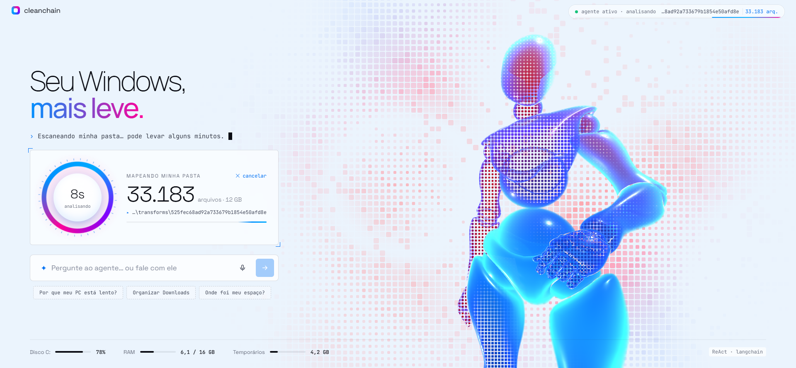

# CleanChain

**Um "CleanMyMac" para Windows com um agente de IA dentro.** Você escolhe um disco, o
CleanChain faz um raio-x completo dele e um agente ReAct (LangChain) conversa com você
sobre o que está ocupando espaço: abre as pastas no mapa enquanto explica, encontra
o que dá para limpar e, **só com a sua confirmação**, manda os arquivos para a Lixeira.


---

## Funcionalidades

- **Scan profundo por disco** — escolha `C:`, `D:`… (ou só a sua pasta de usuário). O
  scan percorre o disco inteiro em paralelo, com progresso em %, pode ser cancelado e
  salva o resultado em JSON.
- **Oportunidades de limpeza** — o scan encontra caches e temporários conhecidos
  (navegadores, npm/pip/Gradle/uv, Temp, Lixeira, node_modules…), **duplicados
  confirmados byte a byte**, arquivos grandes esquecidos há mais de um ano, a idade dos
  dados e as extensões que mais ocupam. O card mostra "Pode liberar ~X GB" e cada
  oportunidade abre uma conversa com o agente sobre ela.
- **Mapa de pastas (sunburst)** — 4 anéis de pastas, navegável por clique, com uma
  tabela que mostra subpastas **e arquivos** da pasta aberta; desce além dos anéis.
- **Tipos de arquivo** — rosca com vídeos, instaladores, imagens, documentos e outros.
- **Agente ReAct no chat** — respostas em streaming, mostrando cada passo
  (Ação → Observação), com memória por conversa.
- **O agente controla a tela** — enquanto explica, ele abre as pastas no sunburst
  (com o selo "aberta pelo agente") e sabe qual pasta você está vendo.
- **Limpeza com aprovação humana** — o agente propõe, a tela mostra um cartão com
  cada item e o total, e nada é apagado até você clicar em "Mover para a Lixeira".
- **Fale com o agente** — botão de microfone com transcrição (Whisper).
- **Visual** — HUD em tema claro, fundo em grade animada e robô holográfico 3D.

## Interface

| Escolha do disco | Scan em andamento |
|---|---|
|  |  |

| Resultado: resumo, sunburst e tipos | Agente abrindo pastas no mapa |
|---|---|
|  |  |


---

## Como funciona

```mermaid
flowchart LR
    subgraph Front["Frontend · React + Vite"]
        UI[Start scan / Sunburst / Chat]
    end
    subgraph Back["Backend · FastAPI"]
        API[/api/*]
        AG[Agente ReAct<br/>LangChain create_agent]
        HITL[HumanInTheLoop<br/>middleware]
        SC[scan_disk]
        DB[(data/scans/latest.json)]
    end
    LLM[(Groq / OpenAI)]

    UI -- "POST /api/scan (NDJSON: progresso → resultado)" --> API --> SC --> DB
    UI -- "POST /api/chat (NDJSON: ação, observação, resposta, ui, approval)" --> API --> AG
    AG <--> LLM
    AG -- "read_last_scan / list_folder" --> DB
    AG -- "focus_folder → evento ui" --> UI
    AG -- "delete_files" --> HITL -- "cartão de aprovação" --> UI
    UI -- "POST /api/chat/approval" --> HITL
```

- **O scan é do usuário, a análise é do agente.** O botão Start scan chama a ferramenta
  `scan_disk` no backend, que salva o resultado. O agente **não escaneia**: ele só lê a
  última análise salva.
- **Tudo em streaming (NDJSON).** Chat, aprovação e scan respondem uma linha JSON por
  evento, então a tela mostra o raciocínio e o progresso ao vivo.
- **Apagar exige aprovação.** O `HumanInTheLoopMiddleware` pausa o loop antes de
  `delete_files`; o front mostra o cartão e retoma com a decisão.

### Ferramentas do agente

| Ferramenta | O que faz |
|---|---|
| `read_last_scan(folder?)` | Resumo da última análise ou detalhes de uma pasta dela |
| `read_scan_insights(kind)` | Oportunidades de limpeza: resumo, caches, duplicados, esquecidos, extensões, idades |
| `list_folder(path)` | Arquivos de uma pasta (para achar caminhos exatos antes de limpar) |
| `focus_folder(path?)` | Abre a pasta no sunburst da tela (vira um evento `ui`) |
| `delete_files(paths, reason)` | Move itens para a Lixeira — **só depois da aprovação** |

### Segurança

- O scan é **somente leitura**; atalhos/junctions são ignorados.
- `delete_files` usa a **Lixeira do Windows** (dá para restaurar) e o backend recusa:
  pastas do sistema e de programas (`Windows`, `Program Files`, `ProgramData`…),
  `pagefile.sys` e afins, raiz de disco, a pasta do usuário e as pastas principais dela
  (Desktop, Downloads, AppData…), qualquer coisa fora da área escaneada e mais de 100
  itens por vez. A validação roda ao montar o cartão **e** de novo na hora de apagar.
- O backend escuta só em `127.0.0.1`, recusa *Host* externo e requisições de outras origens
  (sites abertos no navegador). Os scans salvos (`backend/data/`) ficam fora do git.

---

## Rodando localmente

### Requisitos

- Windows 10/11 (a lista de discos e a Lixeira usam APIs do Windows)
- Node.js 20+ e npm
- Python 3.12+ e [uv](https://docs.astral.sh/uv/)
- Uma chave da **Groq** (grátis) ou da **OpenAI**

### 1. Chave do modelo

Crie um `.env` na raiz do projeto (ou em `backend/.env`):

```env
GROQ_API_KEY=gsk_...
# ou
OPENAI_API_KEY=sk-...
```

| Variável | Padrão | Para quê |
|---|---|---|
| `GROQ_API_KEY` / `OPENAI_API_KEY` | — | Chave do LLM (OpenAI tem prioridade se as duas existirem) |
| `LLM_PROVIDER` | automático | Força `groq` ou `openai` |
| `GROQ_MODEL` | `openai/gpt-oss-20b` | Modelo do agente na Groq |
| `OPENAI_MODEL` | `gpt-6.2-astra` | Modelo do agente na OpenAI |
| `GROQ_STT_MODEL` / `OPENAI_STT_MODEL` | `whisper-large-v3-turbo` / `whisper-1` | Transcrição de voz |

### 2. Backend

```sh
cd backend
uv sync
uv run uvicorn app.server:app --reload --port 8000
```

Para conversar com o agente direto no terminal: `uv run python chat.py`.

Testes das regras de segurança (exclusão, aprovação humana, proteções da API):

```sh
uv run pytest
```

### 3. Frontend

```sh
cd frontend
npm install
npm run dev
```

Abra o endereço que o Vite mostrar (ex.: `http://localhost:5173`). O Vite repassa
`/api` para o backend na porta 8000.

---

## API

| Método | Rota | Descrição |
|---|---|---|
| `GET` | `/api/health` | Modelo em uso e pasta do usuário |
| `GET` | `/api/drives` | Discos locais com espaço total/usado/livre |
| `GET` | `/api/system` | Disco do sistema, RAM e temporários (rodapé) |
| `POST` | `/api/scan` | Inicia o scan (`{path?}`) — NDJSON: `start` → `progress`* → `result` \| `cancelled` \| `error` |
| `POST` | `/api/scan/cancel` | Interrompe o scan em andamento |
| `GET` | `/api/scan/latest` | Último scan salvo |
| `GET` | `/api/folder/files?path=&dirs=` | Arquivos (e subpastas medidas) de uma pasta da área escaneada |
| `POST` | `/api/chat` | Mensagem ao agente (`{message, thread_id, ui_state?}`) — NDJSON |
| `POST` | `/api/chat/approval` | Aprova/recusa a ação pausada (`{thread_id, approve}`) — NDJSON |
| `POST` | `/api/transcribe` | Áudio (multipart `audio`) → `{text}` |

Eventos do chat: `action`, `observation`, `answer` (tokens), `ui` (comando de tela),
`approval` (cartão de confirmação), `error`, `done`.

---

## Estrutura

```
backend/
  app/
    agent.py          agente ReAct (create_agent + memória + aprovação humana)
    server.py         API FastAPI
    stream.py         execução do agente → eventos NDJSON
    storage.py        scans salvos (data/scans/)
    files.py          listagem de pastas e regras de segurança para apagar
    drives.py         discos do Windows
    speech.py         transcrição (Whisper)
    scan_insights.py  caches conhecidos e duplicados (hash parcial → hash completo)
    tools/            scan_disk, read_last_scan, read_scan_insights, list_folder, focus_folder, delete_files
  chat.py             conversa com o agente pelo terminal
frontend/
  src/
    App.jsx           montagem da tela e fluxo agente ⇄ tela
    agent/            hooks e clientes da API (chat, scan, discos, voz…)
    components/       StartScan, Sunburst, ScanCard, ChatThread, ChatInput…
    three/            fundo animado e material holográfico do robô
clarix/               template de referência visual (fundo e robô 3D)
hero-mock/            mocks estáticos das propostas de tela
docs/images/          imagens deste README
```

## Créditos

O fundo animado e o robô holográfico partem do template **Clarix** (GetLayers),
incluído em `clarix/` como referência.
