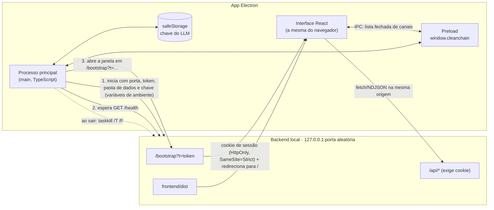

# Guia de desenvolvimento

Como rodar, testar, empacotar e publicar o CleanChain. Visão do produto: [README](../README.md).
Contexto para agentes de código e invariantes do projeto: [AGENTS.md](../AGENTS.md).

## Como funciona por dentro

```mermaid
flowchart LR
    subgraph Front["Frontend · React + Vite"]
        UI[Start scan / Sunburst / Chat]
    end
    subgraph Back["Backend · FastAPI"]
        API[/api/*]
        AG[Agente ReAct<br/>LangChain create_agent]
        HITL[HumanInTheLoop<br/>middleware]
        SC[scan_disk]
        DB[(data/scans/latest.json)]
    end
    LLM[(Groq / OpenAI)]

    UI -- "POST /api/scan (NDJSON: progresso → resultado)" --> API --> SC --> DB
    UI -- "POST /api/chat (NDJSON: ação, observação, resposta, ui, approval)" --> API --> AG
    AG <--> LLM
    AG -- "read_last_scan / list_folder" --> DB
    AG -- "focus_folder → evento ui" --> UI
    AG -- "delete_files" --> HITL -- "cartão de aprovação" --> UI
    UI -- "POST /api/chat/approval" --> HITL
```

- **O scan é do usuário, a análise é do agente.** O botão Start scan chama a ferramenta
  `scan_disk` no backend, que salva o resultado. O agente **não escaneia**: ele só lê a
  última análise salva.
- **Tudo em streaming (NDJSON).** Chat, aprovação e scan respondem uma linha JSON por
  evento, então a tela mostra o raciocínio e o progresso ao vivo.
- **Apagar exige aprovação.** O `HumanInTheLoopMiddleware` pausa o loop antes de
  `delete_files`; o front mostra o cartão e retoma com a decisão.

### App desktop (Electron)



- **O backend é um processo filho.** O Electron inicia o executável do backend (empacotado
  com PyInstaller) numa porta livre aleatória, com um token aleatório de uso único, espera o
  `/health` e abre a janela em `/bootstrap?t=…`. O backend troca o token por um cookie de
  sessão e serve a interface buildada **na mesma origem** da API: `fetch` e streaming NDJSON
  funcionam sem CORS e sem `file://`.
- **Ninguém de fora usa a API.** Sem o cookie, só `/health` e `/bootstrap` respondem (401 no
  resto); o token vale uma vez; porta e token mudam a cada execução.
- **Nada fica rodando.** Ao fechar, o app encerra o backend e todos os processos filhos
  (Windows: `taskkill /T /F`; macOS e Linux: SIGTERM no grupo de processos e, se preciso,
  SIGKILL). Se o Electron for morto à força, o backend percebe e se encerra sozinho.
- **Se o backend cair**, o app mostra o aviso e oferece **Reiniciar**, sem fechar.
- **Janela integrada ao design:** sem a barra de título nativa; a interface vai até o topo,
  os botões da janela ficam numa sobreposição discreta (à esquerda no macOS) e as ações do
  app (chave do modelo, atualizações, logs) ficam num menu próprio no estilo HUD. Abertura e
  avisos de erro usam o mesmo visual. No macOS o app continua ativo ao fechar a janela e
  tem o menu do app (Sobre, Ocultar, Encerrar, Editar).

### Ferramentas do agente

| Ferramenta | O que faz |
|---|---|
| `read_last_scan(folder?)` | Resumo da última análise ou detalhes de uma pasta dela |
| `read_scan_insights(kind)` | Oportunidades de limpeza: resumo, caches, duplicados, esquecidos, extensões, idades |
| `list_folder(path)` | Arquivos de uma pasta (para achar caminhos exatos antes de limpar) |
| `focus_folder(path?)` | Abre a pasta no sunburst da tela (vira um evento `ui`) |
| `delete_files(paths, reason)` | Move itens para a Lixeira — **só depois da aprovação** |

## Rodando localmente

### Requisitos

- Windows 10/11, macOS 12+ (Apple Silicon) ou Linux x64
- Node.js 20+ e npm
- Python 3.12+ e [uv](https://docs.astral.sh/uv/)
- Uma chave da **Groq** (grátis) ou da **OpenAI**, ou uma IA local (**Ollama** ou **LM Studio**)

### 1. Modelo de IA

No modo navegador (desenvolvimento), crie um `.env` na raiz do projeto (ou em `backend/.env`). No app
desktop a chave é configurada na própria tela.

```env
GROQ_API_KEY=gsk_...
# ou
OPENAI_API_KEY=sk-...
```

| Variável | Padrão | Para quê |
|---|---|---|
| `GROQ_API_KEY` / `OPENAI_API_KEY` | — | Chave do LLM (OpenAI tem prioridade se as duas existirem) |
| `LLM_PROVIDER` | automático | Força `groq`, `openai`, ou uma IA local: `ollama` / `lmstudio` |
| `LOCAL_LLM_URL` | `http://127.0.0.1:11434` (Ollama) / `:1234` (LM Studio) | Servidor da IA local — só `127.0.0.1`/`localhost` é aceito |
| `LOCAL_LLM_MODEL` | — | Modelo da IA local (ex.: `qwen3:8b`); precisa saber usar ferramentas |
| `GROQ_MODEL` | `openai/gpt-oss-20b` | Modelo do agente na Groq |
| `OPENAI_MODEL` | `gpt-6.2-astra` | Modelo do agente na OpenAI |
| `GROQ_STT_MODEL` / `OPENAI_STT_MODEL` | `whisper-large-v3-turbo` / `whisper-1` | Transcrição de voz (desligada com IA local) |

### 2. Backend

```sh
cd backend
uv sync
uv run uvicorn app.server:app --reload --port 8000
```

Para conversar com o agente direto no terminal: `uv run python chat.py`.

Testes das regras de segurança (exclusão, aprovação humana, sessão, proteções da API):

```sh
uv run python -m pytest
```

### Avaliação do agente com um modelo de verdade

Os testes do `pytest` não chamam modelo nenhum. Para conferir o que o agente **faz** com um modelo
real (abre a pasta certa no mapa, não oferece pastas protegidas, consulta as oportunidades, limpa
só o que foi pedido, aguenta uma conversa longa), numa pasta de usuário fictícia:

```sh
cd backend
uv run python -m evals.agente                                  # Groq, modelo padrão
uv run python -m evals.agente --modelo openai/gpt-oss-120b     # outro modelo da Groq
uv run python -m evals.agente --local ollama --modelo qwen3:8b # IA local
```

Gasta cota do provedor. No GitHub roda pelo workflow **Avaliação do agente** (à mão e todo dia),
que precisa do segredo `GROQ_API_KEY`; sem ele, o job avisa e não falha.

### 3. Frontend no navegador (só para desenvolver a interface)

> O CleanChain é usado como **app desktop**. O modo navegador existe só para desenvolver a
> interface com hot reload: não tem sessão por cookie nem o cofre da chave, e as garantias de
> segurança (sessão, CSP do Electron, Fuses, MCP) valem para o app desktop. Não use para analisar
> e limpar o disco no dia a dia.

```sh
cd frontend
npm install
npm run dev
```

Abra o endereço que o Vite mostrar (ex.: `http://localhost:5173`). O Vite repassa
`/api` para o backend na porta 8000.

### 4. App desktop em desenvolvimento

```sh
cd desktop
npm install
npm run dev        # Vite com hot reload + Electron; o Electron inicia o backend via uv
```

Não precisa subir o uvicorn à parte: o Electron inicia o backend (`uv run python -m
app.desktop`) na porta 8000 com sessão ligada, e o Vite repassa `/api`, `/bootstrap` e
`/health`. Se o `uv run` falhar na sua máquina, aponte para o Python da venv:
`CLEANCHAIN_PYTHON=..\backend\.venv\Scripts\python.exe`. Para abrir o Electron com a
interface buildada (sem Vite): `npm start`.

Teste de fumaça (abre o app de verdade com um perfil temporário):

```sh
npm run test:fumaca
```

### 5. Gerar o instalador

```sh
cd desktop
npm run dist       # build da interface → PyInstaller → TypeScript → instaladores deste sistema
```

Cada sistema gera os próprios instaladores (o backend do PyInstaller não é multiplataforma),
em `desktop/release/`: `.exe` no Windows, `.dmg`/`.zip` no macOS e `.AppImage`/`.deb` no
Linux. Para publicar, suba a versão em `desktop/package.json` e crie a tag igual (ex.:
`v1.0.1`): o workflow **Release** roda nos três sistemas (testes, PyInstaller, fumaça com o
backend empacotado e com o app final) e, só se os três passarem, publica tudo num Release.
Disparado à mão (Actions › Release › Run workflow) ou em pull requests que mexem no
empacotamento, ele só gera os instaladores como artefatos.

> Com o **Smart App Control** ligado, o Windows bloqueia o executável que o NSIS gera e
> roda durante o build (`spawn UNKNOWN`). Gere o instalador pelo workflow, ou use
> `npx electron-builder --win --dir` para empacotar sem o instalador.

---

## API

| Método | Rota | Descrição |
|---|---|---|
| `GET` | `/health` | Saúde (sem LLM e sem cookie) — usada pelo Electron para esperar o backend |
| `GET` | `/bootstrap?t=` | App desktop: troca o token de uso único pelo cookie de sessão |
| `GET` | `/api/health` | Modelo em uso, se a chave está configurada e pasta do usuário |
| `GET` | `/api/drives` | Discos locais com espaço total/usado/livre |
| `GET` | `/api/system` | Disco do sistema, RAM e temporários (rodapé) |
| `POST` | `/api/scan` | Inicia o scan (`{path?}`) — NDJSON: `start` → `progress`* → `result` \| `cancelled` \| `error` |
| `POST` | `/api/scan/cancel` | Interrompe o scan em andamento |
| `GET` | `/api/scan/latest` | Último scan salvo |
| `GET` | `/api/folder/files?path=&dirs=` | Arquivos (e subpastas medidas) de uma pasta da área escaneada |
| `POST` | `/api/chat` | Mensagem ao agente (`{message, thread_id, ui_state?}`) — NDJSON |
| `POST` | `/api/chat/approval` | Aprova/recusa a ação pausada (`{thread_id, approve}`) — NDJSON |
| `GET` | `/api/propostas` | Propostas de limpeza via MCP aguardando o usuário |
| `POST` | `/api/propostas/{id}/decisao` | Decisão do usuário no app (`{aprovar}`); aprovar manda para a Lixeira |
| `GET` | `/api/mcp/resumo` · `pasta` · `oportunidades` · `arquivos` | Leitura para clientes MCP (token MCP) |
| `POST` / `GET` | `/api/mcp/propostas` · `/api/mcp/propostas/{id}` | Cria proposta / consulta o estado (token MCP) |
| `POST` | `/api/transcribe` | Áudio (multipart `audio`) → `{text}` |

Eventos do chat: `action`, `observation`, `answer` (tokens), `ui` (comando de tela),
`approval` (cartão de confirmação), `error`, `done`.

No app desktop, tudo menos `/health` e `/bootstrap` exige o cookie de sessão (401 sem ele).
As rotas `/api/mcp/*` exigem, em vez do cookie, o token MCP — e só com a integração ligada.
O backend também serve a interface buildada em `/`.

---

## Estrutura

```
backend/
  app/
    agent.py          agente ReAct (create_agent + memória + aprovação humana)
    server.py         API FastAPI (+ /health, /bootstrap e a interface buildada)
    config.py         configuração por ambiente (porta, token, pasta de dados…)
    sessao.py         token de uso único → cookie de sessão (app desktop)
    interface.py      serve frontend/dist com CSP e tipos MIME corretos
    desktop.py        ponto de entrada do app desktop (127.0.0.1 + vigia do Electron)
    stream.py         execução do agente → eventos NDJSON
    storage.py        scans salvos (pasta de dados/scans/)
    files.py          listagem de pastas e regras de segurança para apagar
    units.py          formatação de tamanhos (bytes → "1.2 GB")
    drives.py         discos, RAM e temporários (via plataforma)
    plataforma/       o que muda por sistema: windows.py, macos.py, linux.py
    speech.py         transcrição (Whisper)
    scan_insights.py  caches conhecidos e duplicados (hash parcial → hash completo)
    tools/            scan_disk, read_last_scan, read_scan_insights, list_folder, focus_folder, delete_files
  chat.py             conversa com o agente pelo terminal
  cleanchain-backend.spec   PyInstaller (onedir) do backend do app desktop
  cleanchain_mcp/     servidor MCP (stdio): ponte entre clientes MCP e o app
  cleanchain-mcp.spec PyInstaller do executável cleanchain-mcp
frontend/
  src/
    App.jsx           montagem da tela e fluxo agente ⇄ tela
    agent/            hooks e clientes da API (chat, scan, discos, voz, ponte desktop…)
    components/       StartScan, ConfigChave, Sunburst, ScanCard, ChatThread, ChatInput…
    three/            fundo animado e material holográfico do robô
desktop/
  main/               processo principal (backend filho, segurança, IPC, chave, atualização)
  preload/            ponte window.cleanchain (contextBridge)
  tests/              teste de fumaça (Playwright)
  scripts/            modo de desenvolvimento e geração do ícone
  build/icon.png      ícone do app (instalador, .exe e janela)
  electron-builder.yml   instalador NSIS, Fuses e publicação
.github/workflows/    CI (testes) e Release (instalador por tag)
docs/images/          imagens deste README (inclui logo.png)
```

### Ícone

O ícone é a marca do cabeçalho da interface (`.brand__mark`: gradiente azul → rosa →
violeta com o centro claro) e é o mesmo em todo lugar: instalador, executável, janela do
app, aba do navegador (`frontend/public/favicon.png`) e o topo deste README. Para
regenerar todos os tamanhos a partir da marca:

```sh
cd desktop
npm run icone
```
