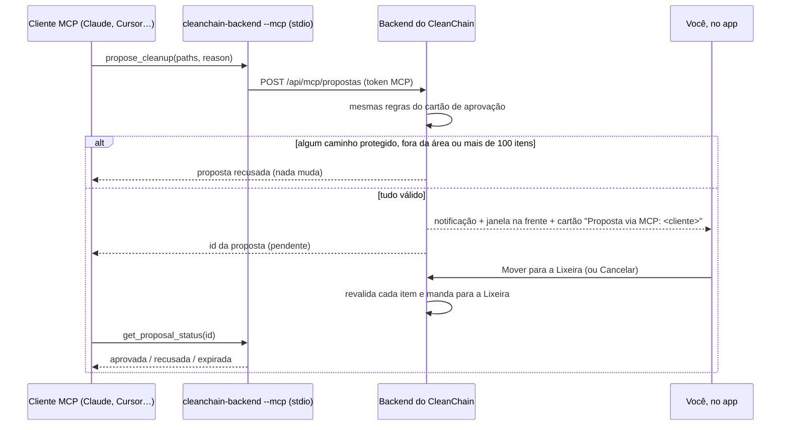

# Integração MCP

Como conectar Claude Desktop, Claude Code, Cursor e outros clientes MCP ao CleanChain, e como a
integração protege o seu disco. Visão geral e lista de ferramentas: README, seção
[Usando via MCP](../README.md#usando-via-mcp).

## Onde fica o executável

O servidor MCP é o próprio backend do app no modo `--mcp` (transporte stdio), instalado junto com
o app:

| Sistema | Comando |
|---|---|
| Windows | `%LOCALAPPDATA%\Programs\CleanChain\resources\backend\cleanchain-backend.exe --mcp` |
| macOS | `/Applications/CleanChain.app/Contents/Resources/backend/cleanchain-backend --mcp` |
| Linux (`.deb`) | `/opt/CleanChain/resources/backend/cleanchain-backend --mcp` |

> Configurou com a versão 1.0.x (o antigo `resources\mcp\cleanchain-mcp`)? Copie a configuração
> de novo na tela "Integração MCP".

No **AppImage** o caminho muda a cada abertura, então a integração MCP precisa do `.deb`. A tela
"Integração MCP" mostra o caminho exato da sua instalação.

## Configuração dos clientes

O botão **Copiar configuração** já gera o texto com o caminho certo. Os exemplos abaixo usam o
caminho do Windows; troque pelo do seu sistema.

**Claude Desktop**: em *Settings › Developer › Edit Config* (`claude_desktop_config.json`):

```json
{
  "mcpServers": {
    "cleanchain": {
      "command": "C:\\Users\\<você>\\AppData\\Local\\Programs\\CleanChain\\resources\\backend\\cleanchain-backend.exe",
      "args": ["--mcp"]
    }
  }
}
```

**Claude Code**: no terminal:

```sh
claude mcp add --scope user cleanchain -- "C:\Users\<você>\AppData\Local\Programs\CleanChain\resources\backend\cleanchain-backend.exe" --mcp
```

**Cursor**: em `~/.cursor/mcp.json` (mesmo formato do Claude Desktop):

```json
{
  "mcpServers": {
    "cleanchain": {
      "command": "/Applications/CleanChain.app/Contents/Resources/backend/cleanchain-backend",
      "args": ["--mcp"]
    }
  }
}
```

Outros clientes MCP (VS Code, agentes próprios) usam o mesmo comando com transporte **stdio**.

## Fluxo de aprovação



- A proposta passa pelas **mesmas regras** do chat (pastas protegidas, área escaneada, até 100
  itens) e é **recusada inteira** se qualquer caminho for bloqueado.
- Ao chegar uma proposta, o app mostra uma notificação do sistema e traz a janela para a frente,
  com o cartão de aprovação e o selo **"Proposta via MCP: <nome do cliente>"** (o nome que o
  cliente informa ao conectar).
- **Só o seu clique no app apaga**, com a mesma validação dupla de sempre (no cartão e de novo
  na hora de mandar para a Lixeira). Propostas sem decisão **expiram em 30 minutos**.

## Segurança da integração

- O app grava `runtime.json` (porta, um token MCP novo a cada abertura e o PID) na pasta de dados,
  com permissão só para o seu usuário, **apenas com a integração ligada**, e o apaga ao desligar ou
  ao fechar o app.
- As rotas `/api/mcp/*` aceitam **só** esse token e só leem ou criam propostas. As rotas de
  aprovação exigem a sessão da interface do app, e o token MCP não chega nelas.
- Com a integração desligada, o backend recusa todas as rotas MCP.
